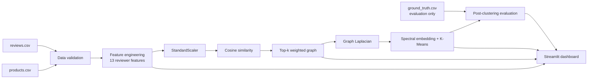
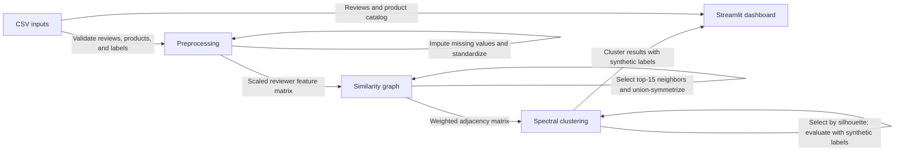
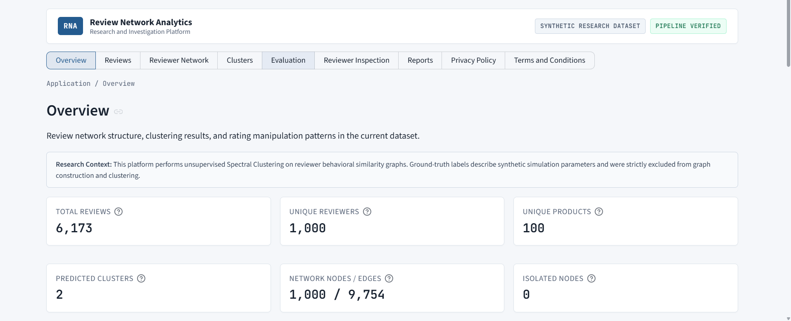
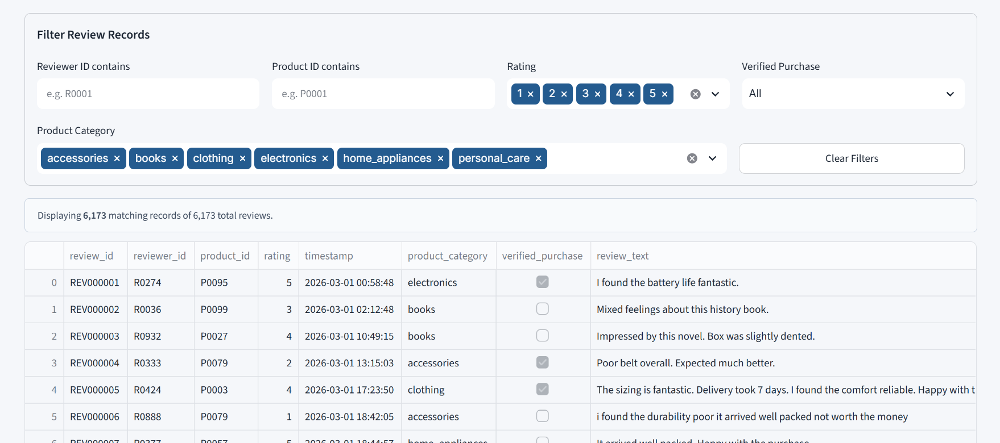
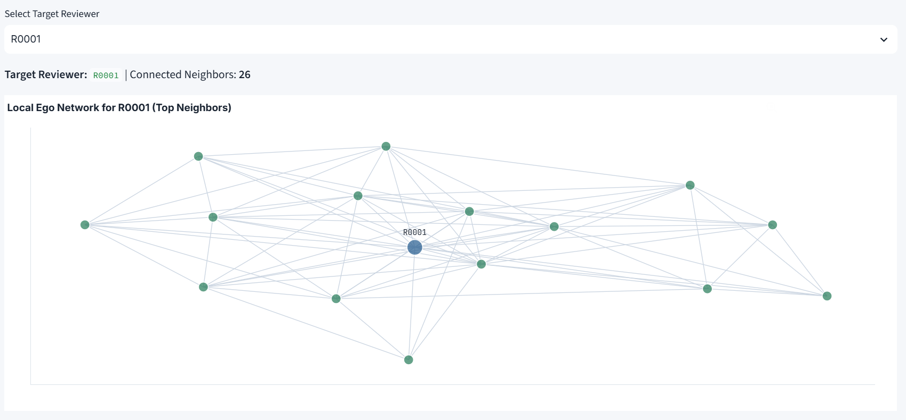
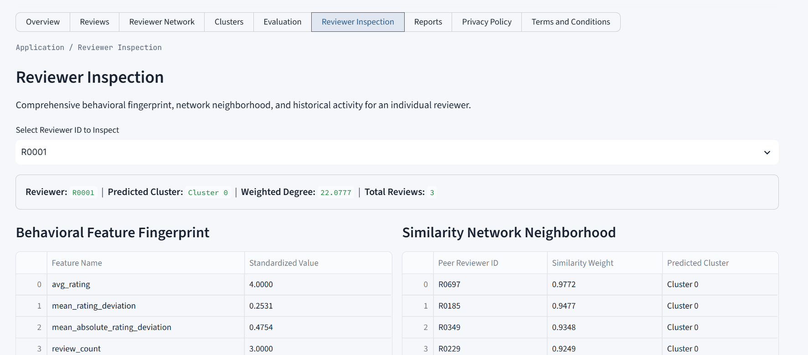

# Review Network Analytics (RNA)

## Detection of Coordinated Fake Product Review Networks Using Spectral Clustering

An unsupervised machine learning system that detects potentially coordinated fake review networks by analyzing reviewer behavioral patterns using **Spectral Clustering** on similarity graphs.

> **⚠️ Academic Project — Synthetic Data:** This project uses a synthetically generated dataset for demonstration. Cluster assignments indicate behavioral similarity, not proven fraud.

---

## Problem Statement

Coordinated review manipulation may involve reviewers with similar rating, timing, activity, and product-selection behavior. RNA represents reviewers as graph nodes, behavioral similarity as weighted edges, and uses spectral clustering to explore the resulting network structure.

## Objectives

- Validate the supplied review, product, and evaluation-label tables.
- Engineer and standardize reviewer-level behavioral features without leaking evaluation labels.
- Construct a cosine-similarity graph and inspect its connectivity.
- Apply spectral clustering and compare partitions with synthetic labels.
- Provide interactive views for exploring reviews, neighbors, clusters, metrics, and reports.

## Key Features

- Three reproducible command-line pipeline stages and a Streamlit dashboard.
- Thirteen reviewer-level features with explicit missing-value treatment.
- Top-15 nearest-neighbor graph construction with union symmetrization; an optional threshold strategy is also available.
- Normalized and unnormalized Laplacian options, a k sweep, and silhouette-based default model selection.
- Ground-truth labels are excluded from model inputs and used for post-clustering evaluation and dashboard reference.
- Tests cover validation, feature engineering, graph construction, clustering, evaluation, and dashboard data consistency.

## Project Architecture

```
Module 1: Data Validation & Feature Engineering
    ↓  13 reviewer-level behavioral features (StandardScaler normalized)
Module 2: Similarity Network & Graph Construction
    ↓  Cosine similarity → Top-k weighted graph (1000 nodes, ~10k edges)
Module 3: Spectral Clustering & Evaluation
    ↓  Normalized Laplacian → Spectral embedding → K-Means
Module 4: Interactive Streamlit Dashboard
    ↓  Visualization, exploration, and evaluation interface
```

## System Architecture (Mermaid)



## End-to-End Workflow



## Quick Start

### 1. Install Dependencies

```bash
python -m venv .venv
```

Activate the environment and install dependencies:

```powershell
# Windows PowerShell
.\.venv\Scripts\Activate.ps1
python -m pip install -r requirements.txt
```

```bash
# macOS / Linux
source .venv/bin/activate
python -m pip install -r requirements.txt
```

Run the following commands from the repository root.

### 2. Run the Pipeline

```bash
# Module 1: Data Validation & Feature Engineering
python -m src.preprocessing --data-dir data --output-dir outputs

# Module 2: Similarity Network & Graph Construction
python -m src.similarity_graph --input-dir outputs --output-dir outputs/graph

# Module 3: Spectral Clustering & Evaluation
python -m src.spectral_clustering --graph-dir outputs/graph --features-dir outputs --output-dir outputs/clustering
```

### 3. Launch the Dashboard

```bash
streamlit run app.py
```

### 4. Run Tests

The integration tests expect generated pipeline artifacts. Run the three pipeline stages above before testing a fresh checkout.

```bash
python -m pytest -q
```

---

## Module Details

### Module 1 — Data Validation & Feature Engineering

**Source:** `src/data_validation.py`, `src/feature_engineering.py`, `src/preprocessing.py`

- Validates reviews, products, and ground-truth CSV files
- Engineers 13 reviewer-level behavioral features:
  - `avg_rating`, `mean_rating_deviation`, `mean_absolute_rating_deviation`
  - `review_count`, `reviews_per_day`
  - `avg_review_length_words`, `avg_review_length_chars`
  - `unique_products_reviewed`, `product_category_count`, `product_category_entropy`
  - `avg_inter_review_hours`, `review_time_std_hours`
  - `verified_purchase_ratio`
- Applies StandardScaler normalization
- Ground-truth labels are strictly separated from features (leakage prevention)

The feature matrix contains these 13 values:

| Feature | Meaning |
|---|---|
| `avg_rating` | Mean rating submitted by the reviewer |
| `mean_rating_deviation` | Mean signed difference between each rating and that product's mean rating |
| `mean_absolute_rating_deviation` | Mean absolute difference from the corresponding product mean |
| `review_count` | Number of reviews by the reviewer |
| `reviews_per_day` | Review count divided by the span between first and last review; a single-review reviewer receives 1 |
| `avg_review_length_words` | Mean number of whitespace-separated words in review text |
| `avg_review_length_chars` | Mean number of characters in review text |
| `unique_products_reviewed` | Number of distinct products reviewed |
| `product_category_count` | Number of distinct product categories reviewed |
| `product_category_entropy` | Shannon entropy of the reviewer's category distribution (natural logarithm) |
| `avg_inter_review_hours` | Mean interval between consecutive reviews |
| `review_time_std_hours` | Standard deviation of inter-review intervals |
| `verified_purchase_ratio` | Fraction of the reviewer's records marked verified |

Missing temporal values for reviewers with too few reviews are filled with zero during preprocessing; other missing numerical values are filled with the column median. The `campaign_id` and other ground-truth fields are excluded from the feature matrix.

**Outputs:** `outputs/reviewer_features.csv`, `outputs/reviewer_features_scaled.csv`, `outputs/reviewer_ground_truth.csv`

### Module 2 — Similarity Network & Graph Construction

**Source:** `src/similarity_graph.py`, `src/graph_validation.py`

- Computes pairwise cosine similarity between reviewer feature vectors
- Constructs weighted undirected graph using top-k nearest neighbours (k=15, union symmetrization)
- Also supports threshold-based edge selection (`--strategy threshold --threshold 0.3`)
- Computes adjacency matrix W, degree matrix D, unnormalized Laplacian L=D−W, and normalized Laplacian
- Validates graph invariants and writes graph statistics and a validation report

**Outputs:** `outputs/graph/` (adjacency matrix, Laplacian, GraphML, statistics, visualization)

### Module 3 — Spectral Clustering & Evaluation

**Source:** `src/spectral_clustering.py`, `src/clustering_evaluation.py`

- Computes spectral embedding from the normalized graph Laplacian
- Applies K-Means with multiple initializations
- Evaluates k=2 through k=8, selects primary k by Silhouette Score (unsupervised)
- Evaluates against synthetic ground-truth using ARI and NMI
- Generates contingency tables and cluster behavioral profiles

**Outputs:** `outputs/clustering/` (assignments, metrics, behavior summary, evaluation report)

The normalized symmetric Laplacian is `L_sym = I - D^(-1/2) W D^(-1/2)`. The implementation uses the eigenvectors corresponding to the smallest eigenvalues, row-normalizes the embedding, and applies K-Means with 20 initializations (`random_state=42`, `max_iter=300`). By default it sweeps `k=2..8` and selects the successful run with the highest silhouette score; `--k-primary` can override that selection.

The default graph strategy selects up to 15 positive-similarity neighbors per reviewer. An undirected edge is retained when either endpoint selected the other (union symmetrization); its weight is the cosine similarity. The code also supports a threshold-based edge strategy.

The existing saved outputs report 1,000 reviewer nodes, 9,754 edges, one connected component, and no isolated nodes. These describe the supplied run, not guarantees for other data.

### Verified Sample Results

The existing `outputs/clustering/experiment_summary.json` reports the following for the supplied run:

| Result | Value |
|---|---:|
| Selected `k` | 2 |
| Silhouette score | 0.7028 |
| ARI against synthetic categories | 0.1224 |
| NMI against synthetic categories | 0.1721 |

Silhouette describes separation in the spectral embedding. ARI and NMI show modest agreement with the synthetic categories; none of these results establishes real-world fraud detection performance. Cluster IDs are arbitrary.

### Module 4: Review Network Analytics Dashboard

**Source:** `app.py`

Interactive Streamlit research dashboard with nine navigation sections:

| Section | Description |
|---|---|
| Overview | Dataset statistics, verification status, distributions, and architecture |
| Reviews | Filterable review explorer with multi-attribute search and reviewer action |
| Reviewer Network | Interactive local ego network, global topology, and degree distribution |
| Clusters | Unsupervised cluster profiles, separate positive/negative manipulation analysis, and member explorer |
| Evaluation | Metric definitions (ARI, NMI, Silhouette), multi-k parameter sweep, and contingency matrix |
| Reviewer Inspection | Comprehensive behavioral feature fingerprint, peer similarity, review history, and quarantined ground truth |
| Reports | Validated artifact downloads and live pipeline execution panel |
| Privacy Policy | Transparency, data handling practices, and local execution boundaries |
| Terms and Conditions | Research scope, analytical limitations, and responsible interpretation guidelines |

---

## Output Directory Structure

```
outputs/
├── reviewer_features.csv              # Raw features (1000 × 13)
├── reviewer_features_scaled.csv       # Scaled features (1000 × 13)
├── reviewer_ground_truth.csv          # Evaluation-only labels
├── reports/
│   ├── module1_validation_report.json
│   └── module1_validation_report.txt
├── graph/
│   ├── graph_adjacency_matrix.csv     # Weighted adjacency matrix
│   ├── graph_degree_matrix.csv        # Diagonal degree values
│   ├── graph_laplacian.csv            # Unnormalized Laplacian
│   ├── graph_laplacian_normalized.npy # Normalized Laplacian
│   ├── reviewer_node_mapping.csv      # Reviewer ↔ matrix index
│   ├── reviewer_network.graphml       # NetworkX GraphML export
│   ├── graph_statistics.json          # Graph structure stats
│   └── graph_validation_report.txt    # Graph structural checks
├── clustering/
│   ├── reviewer_cluster_assignments.csv  # Predicted clusters
│   ├── clustering_metrics.csv            # ARI/NMI/Silhouette for k=2..8
│   ├── cluster_behavior_summary.csv      # Per-cluster behavioral profiles
│   ├── cluster_ground_truth_comparison.csv # Contingency table
│   ├── experiment_summary.json           # Full experiment config
│   └── evaluation_report.txt             # Human-readable evaluation
└── figures/
    ├── reviewer_network.png           # Graph visualization
    ├── spectral_embedding.png         # Embedding scatter plot
    ├── ground_truth_comparison.png    # Predicted vs ground-truth
    ├── cluster_behavior.png           # Behavioral bar charts
    └── k_evaluation.png               # Metric comparison across k
```

---

## Evaluation Methodology

- **Adjusted Rand Index (ARI):** Measures agreement between predicted clusters and ground-truth categories, adjusted for chance. Range [-1, 1].
- **Normalized Mutual Information (NMI):** Measures information-based agreement. Range [0, 1].
- **Silhouette Score:** Measures structural cluster separation in spectral embedding space. Does NOT use ground-truth. Range [-1, 1].

Primary k is selected by Silhouette Score (unsupervised criterion). ARI and NMI are reported afterward for evaluation only.

---

## Dataset

The supplied dataset is described as synthetic and is suitable only as a benchmark/demo dataset:

- **6,173 reviews** by **1,000 reviewers** across **100 products**
- 4 reviewer categories: `normal` (625), `positive_manipulation` (141), `negative_manipulation` (138), `ambiguous` (96)
- Review timestamps cover March 1 through August 31, 2026.
- `reviews.csv` includes `campaign_id`; the feature-engineering module explicitly removes this and other label columns before feature computation.
- `ground_truth.csv` contains evaluation labels and must not be used as model input.

The dataset documentation describes a generator, but that generator is not present in this repository. The included CSVs can be analyzed, but their generation process cannot be rerun from this checkout.

---

## Limitations and Responsible Interpretation

1. **Synthetic data:** Results reflect generated patterns, not real-world fraud detection performance.
2. **Cluster IDs are arbitrary:** Cluster 0 is not automatically "normal" and Cluster 1 is not automatically "fraudulent."
3. **Behavioral similarity ≠ fraud proof:** Membership in a suspicious-looking cluster indicates shared behavioral patterns, not proven coordination.
4. **Unsupervised method:** The algorithm discovers structure without labels. ARI/NMI evaluate how well this structure aligns with synthetic categories.
5. **Moderate agreement:** ARI ~0.12 and NMI ~0.17 reflect that unsupervised behavioral clustering captures some, but not all, of the ground-truth structure.
6. **Static aggregation:** Reviewer-level aggregation can hide short-lived behavior and temporal changes.
7. **Dense pairwise computation:** Similarity and eigendecomposition use dense matrices; larger datasets may require sparse or approximate methods.

## Application Screenshots

The following screenshots show key views of the Review Network Analytics dashboard.

### Dashboard Overview

The main dashboard overview.



### Reviews Explorer

The dashboard's review exploration view.



### Reviewer Network

The dashboard's reviewer network view.



### Reviewer Inspection

The dashboard's reviewer inspection view.



The dashboard stylesheet imports Google Fonts. Viewing the app with network access can therefore trigger an external font request; the data-processing pipeline itself reads and writes local files.

## Future Enhancements

- Include and document the dataset-generation source and provenance.
- Evaluate against appropriately licensed real-world or independently generated benchmarks.
- Explore temporal or bipartite graph features and sparse/approximate similarity methods for larger datasets.
- Add cluster-stability analyses beyond a single silhouette criterion.
- Add dedicated dashboard interaction tests.

---

## Technologies and Dependencies

- Python 3.10 or newer
- numpy, pandas, scikit-learn
- networkx, matplotlib
- streamlit, plotly
- pytest (testing; required by the test suite)
- Supported version ranges are defined in `requirements.txt`.

---

## License

No license has been selected. Do not treat this repository as open-source licensed until the owner chooses and adds a license.
